# MANUAL TÉCNICO — PROYECTO 1: "CHAPIN RED"
### Redes de Computadoras 2 — Facultad de Ingeniería, USAC
### Primer Semestre 2026

---

> **Estudiante:** Estuardo Josué Vaquiax Reyes  
> **Carné:** 202201336  
> **Terminación de Carné (X):** 36  
> **Paridad del Carné:** PAR → Protocolo de Enrutamiento: **OSPFv2**  
> **Repositorio:** `REDES2_1S2026_202201336`  
> **Ruta del Proyecto:** `REDES2_1S2026_202201336/Proyecto1/`  
> **Archivo de Simulación:** `Proyecto1_202201336.pkt`

---

## TABLA DE CONTENIDOS

1. [Descripción General del Proyecto](#1-descripción-general-del-proyecto)
2. [Arquitectura de Red y Topología](#2-arquitectura-de-red-y-topología)
3. [Diseño de VLANs y VTP](#3-diseño-de-vlans-y-vtp)
4. [Esquema de Direccionamiento IP (Subnetting)](#4-esquema-de-direccionamiento-ip-subnetting)
5. [Agregación de Enlaces — EtherChannel](#5-agregación-de-enlaces--etherchannel)
6. [Enrutamiento Dinámico OSPFv2](#6-enrutamiento-dinámico-ospfv2)
7. [Servicios DHCP Centralizado y Relay](#7-servicios-dhcp-centralizado-y-relay)
8. [Políticas de Seguridad — Listas de Control de Acceso (ACLs)](#8-políticas-de-seguridad--listas-de-control-de-acceso-acls)
9. [Configuraciones Completas por Dispositivo](#9-configuraciones-completas-por-dispositivo)
10. [Protocolo de Pruebas y Verificación](#10-protocolo-de-pruebas-y-verificación)
11. [Tolerancia a Fallos](#11-tolerancia-a-fallos)
12. [Glosario Técnico](#12-glosario-técnico)

---

## 1. Descripción General del Proyecto

El proyecto **"Chapin Red"** consiste en el diseño, implementación y verificación de una infraestructura de red metropolitana (MAN) que interconecta dos edificios corporativos mediante una red núcleo en anillo. La solución integra tecnologías de capa 2 y capa 3 avanzadas, contemplando alta disponibilidad, segmentación lógica de tráfico, asignación dinámica de direcciones IP centralizada y políticas de seguridad perimetral.

### Tecnologías Implementadas

| Capa OSI | Tecnología | Propósito |
|---|---|---|
| L2 | VLAN / VTP | Segmentación lógica del tráfico |
| L2 | IEEE 802.1Q Trunk | Transporte de múltiples VLANs en un enlace |
| L2 | LACP (802.3ad) | EtherChannel en Edificio Izquierdo |
| L2 | PAgP (Cisco) | EtherChannel en Edificio Derecho |
| L3 | OSPFv2 Área 0 | Enrutamiento dinámico en la MAN |
| L3 | DHCP / IP Helper | Asignación de IPs centralizada |
| L3 | ACLs Extendidas | Control de acceso y seguridad perimetral |
| L3 | SVI (Switched Virtual Interface) | Gateway de capa 3 en cada VLAN |

---

## 2. Arquitectura de Red y Topología

La red se divide en tres zonas funcionales: la **Red MAN** (núcleo metropolitano), el **Edificio Izquierdo** y el **Edificio Derecho**.

### 2.1 Vista General de la Topología

```
                    +------------------------------------------+
                    |           RED MAN (ANILLO L3)            |
                    |                                          |
       DHCP1 ---- [ MSW_MAN_TOP (RID 1.1.1.1) ] ---- DHCP2   |
                   /   Gig1/1/1      Gig1/1/2   \             |
                  /                               \            |
        Gig1/1/2 /                                 \ Gig1/1/1 |
   [MSW_MAN_LEFT]                                 [MSW_MAN_RIGHT]
    (RID 2.2.2.2)                                 (RID 3.3.3.3)
        Gig1/1/1 \                                 / Gig1/1/2 |
                  \                               /            |
                   \   Gig1/1/2      Gig1/1/1   /             |
                    [ MSW_MAN_ADMIN (RID 4.4.4.4) ]           |
                              |                                |
                             PC0 (VLAN ADMIN)                  |
                    +------------------------------------------+
                         |                        |
                    Gig1/0/4                  Gig1/0/1
                         |                        |
                       Fa0/4                    Fa0/1
              +-----------------+      +-----------------+
              |  MSW_CORE_IZQ   |      |  MSW_CORE_DER   |
              |  (RID 5.5.5.5)  |      |  (RID 6.6.6.6)  |
              +--------+--------+      +--------+--------+
                       | (LACP)                 | (PAgP)
              +--------+---------+     +--------+---------+
              |   MSW_DIST_IZQ   |     |   MSW_DIST_DER   |
              +------+-------+---+     +---+--------------+
                     |       |             |
              +------+   +---+     +-------+-------+
              |          |         |               |
       +------+--+ +-----+---+ +---+-----+  +-----+---+
       |SW1_ACC  | |SW2_ACC  | |SW3_ACC  |  |SW4_ACC  |
       |_IZQ     | |_IZQ     | |_DER     |  |_DER     |
       +---------+ +---------+ +---------+  +---------+
       PCs VLAN10  PCs VLAN20  PCs VLAN30   PCs VLAN40
       PCs VLAN20  PCs VLAN10  PCs VLAN40   PCs VLAN30
```
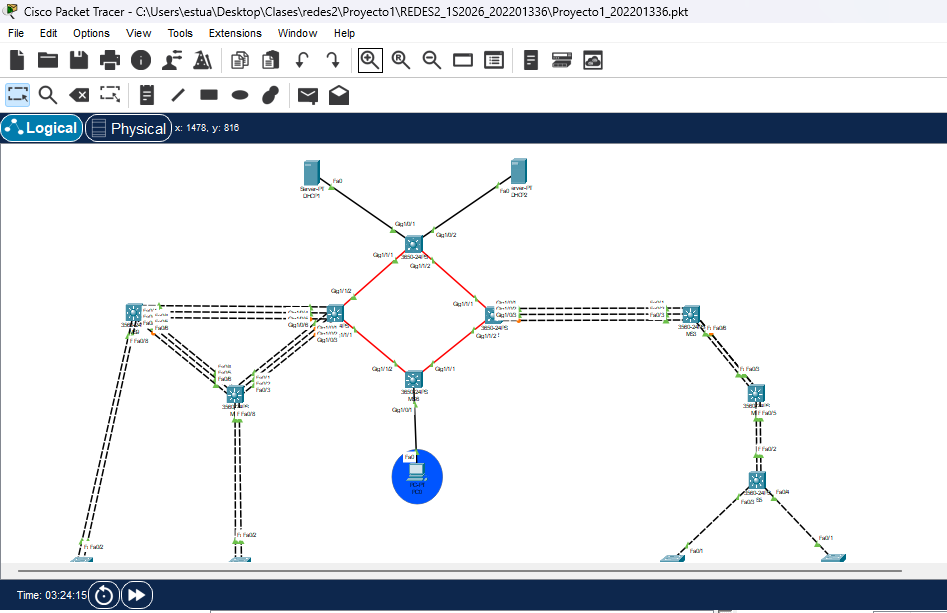
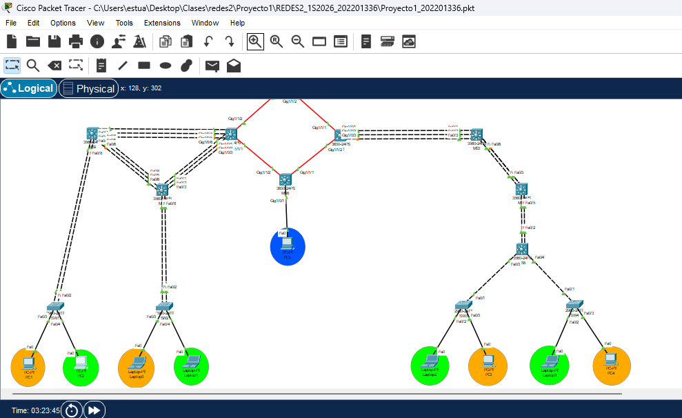

### 2.2 Descripción de Dispositivos

#### Red MAN — Switches Multicapa Cisco Catalyst 3650

| Dispositivo | Rol | Router-ID OSPF | Conexiones Clave |
|---|---|---|---|
| `MSW_MAN_TOP` | Core MAN / Gateway DHCP | 1.1.1.1 | DHCP1, DHCP2, MSW_MAN_LEFT, MSW_MAN_RIGHT |
| `MSW_MAN_LEFT` | Demarcación Edificio IZQ | 2.2.2.2 | MSW_MAN_TOP, MSW_MAN_ADMIN, MSW_CORE_IZQ |
| `MSW_MAN_RIGHT` | Demarcación Edificio DER | 3.3.3.3 | MSW_MAN_TOP, MSW_MAN_ADMIN, MSW_CORE_DER |
| `MSW_MAN_ADMIN` | Gateway VLAN ADMIN | 4.4.4.4 | MSW_MAN_LEFT, MSW_MAN_RIGHT, PC0 |

#### Edificio Izquierdo — Cisco 3560 / 2960

| Dispositivo | Capa Jerárquica | Protocolo EtherChannel | Port-Channels |
|---|---|---|---|
| `MSW_CORE_IZQ` | Core (L3) | LACP activo | Po1 (hacia DIST), Po2 (hacia DIST) |
| `MSW_DIST_IZQ` | Distribución (L2) | LACP activo | Po1, Po2, Po3 |
| `SW1_ACCESO_IZQ` | Acceso (L2) | LACP activo | Po1 |
| `SW2_ACCESO_IZQ` | Acceso (L2) | LACP activo | Po2 |

#### Edificio Derecho — Cisco 3560 / 2960

| Dispositivo | Capa Jerárquica | Protocolo EtherChannel | Port-Channels |
|---|---|---|---|
| `MSW_CORE_DER` | Core (L3) | PAgP desirable | Po10 |
| `MSW_DIST_DER` | Distribución (L2) | PAgP desirable/auto | Po10, Po20 |
| `SW3_ACCESO_DER` | Acceso (L2) | PAgP auto | Po20 |
| `SW4_ACCESO_DER` | Acceso (L2) | PAgP auto | — |

---

## 3. Diseño de VLANs y VTP

### 3.1 Protocolo VTP (VLAN Trunking Protocol)

VTP permite la propagación automática de la base de datos de VLANs desde un servidor central hacia todos los switches clientes del dominio, eliminando la necesidad de configurar VLANs manualmente en cada dispositivo.

| Parámetro | Valor |
|---|---|
| **Dominio VTP** | `CHAPINRED_202201336` |
| **Modo en Core/Dist** | `server` |
| **Modo en Acceso** | `client` |
| **Versión** | 2 |

> **Nota:** Todos los switches deben pertenecer al mismo dominio VTP antes de que la propagación funcione. Los switches en modo `client` no pueden crear ni eliminar VLANs localmente.

### 3.2 Tabla de VLANs del Proyecto

| ID VLAN | Nombre Oficial VTP | Edificio | Color | Propósito |
|---|---|---|---|---|
| **10** | `VLAN_Naranja_EdificioIZQ_202201336` | Izquierdo | Naranja | Hosts usuarios Edificio IZQ |
| **20** | `VLAN_Verde_EdificioIZQ_202201336` | Izquierdo | Verde | Hosts usuarios Edificio IZQ |
| **30** | `VLAN_Naranja_EdificioDER_202201336` | Derecho | Naranja | Hosts usuarios Edificio DER |
| **40** | `VLAN_Verde_EdificioDER_202201336` | Derecho | Verde | Hosts usuarios Edificio DER |
| **99** | `VLAN_ADMIN_EdificioADMIN_202201336` | MAN/ADMIN | Admin | Gestión y administración |

### 3.3 Lógica de Segmentación

La segmentación por colores impone la siguiente política de comunicación:

```
  VLAN Naranja IZQ (10) <---- PERMITIDO ----> VLAN Naranja DER (30)
  VLAN Verde IZQ   (20) <---- PERMITIDO ----> VLAN Verde DER   (40)
  VLAN Naranja (10/30)  <---- DENEGADO -----> VLAN Verde (20/40)
  VLAN Admin   (99)     <---- ACCESO TOTAL -> Cualquier VLAN
  Cualquier VLAN        <---- DENEGADO -----> VLAN Admin (99) [inicio]
```

---

## 4. Esquema de Direccionamiento IP (Subnetting)

### 4.1 Red de VLANs de Usuario: `192.188.36.0/24` — VLSM

Se aplicó **Variable Length Subnet Masking (VLSM)** para asignar subredes proporcionales al número de hosts requerido por cada VLAN.

| VLAN | Red / Prefijo | Máscara | Wildcard | Gateway (SVI) | Rango Útil | Broadcast | Hosts Máx. |
|---|---|---|---|---|---|---|---|
| **10** (Naranja IZQ) | `192.188.36.0/26` | `255.255.255.192` | `0.0.0.63` | `192.188.36.1` | .2 – .62 | `192.188.36.63` | 62 |
| **20** (Verde IZQ) | `192.188.36.64/26` | `255.255.255.192` | `0.0.0.63` | `192.188.36.65` | .66 – .126 | `192.188.36.127` | 62 |
| **30** (Naranja DER) | `192.188.36.128/27` | `255.255.255.224` | `0.0.0.31` | `192.188.36.129` | .130 – .158 | `192.188.36.159` | 30 |
| **40** (Verde DER) | `192.188.36.160/27` | `255.255.255.224` | `0.0.0.31` | `192.188.36.161` | .162 – .190 | `192.188.36.191` | 30 |
| **99** (ADMIN) | `192.188.36.192/27` | `255.255.255.224` | `0.0.0.31` | `192.188.36.193` | .194 – .222 | `192.188.36.223` | 30 |

> **PC0 (Administración):** IP estática `192.188.36.194` — primer host disponible en VLAN 99.

### 4.2 Red de Enlaces L3 Punto a Punto: `10.4.36.0/24` — FLSM /30

Se utilizó **Fixed Length Subnet Masking (FLSM)** con prefijo `/30` (2 hosts útiles por subred) para todos los enlaces de enrutamiento entre dispositivos de capa 3 en la MAN. Esta es la práctica estándar en ingeniería de redes para enlaces punto a punto.

**Máscara:** `255.255.255.252` | **Wildcard:** `0.0.0.3`

| # | Subred | Dispositivo A | Interfaz A | IP A | Dispositivo B | Interfaz B | IP B |
|---|---|---|---|---|---|---|---|
| 1 | `10.4.36.0/30` | MSW_MAN_TOP | Gig1/0/1 | `10.4.36.1` | DHCP1 | Fa0 | `10.4.36.2` |
| 2 | `10.4.36.4/30` | MSW_MAN_TOP | Gig1/0/2 | `10.4.36.5` | DHCP2 | Fa0 | `10.4.36.6` |
| 3 | `10.4.36.8/30` | MSW_MAN_TOP | Gig1/1/1 | `10.4.36.9` | MSW_MAN_LEFT | Gig1/1/2 | `10.4.36.10` |
| 4 | `10.4.36.12/30` | MSW_MAN_TOP | Gig1/1/2 | `10.4.36.13` | MSW_MAN_RIGHT | Gig1/1/1 | `10.4.36.14` |
| 5 | `10.4.36.16/30` | MSW_MAN_LEFT | Gig1/1/1 | `10.4.36.17` | MSW_MAN_ADMIN | Gig1/1/2 | `10.4.36.18` |
| 6 | `10.4.36.20/30` | MSW_MAN_RIGHT | Gig1/1/2 | `10.4.36.21` | MSW_MAN_ADMIN | Gig1/1/1 | `10.4.36.22` |
| 7 | `10.4.36.24/30` | MSW_MAN_LEFT | Gig1/0/4 | `10.4.36.25` | MSW_CORE_IZQ | Fa0/4 | `10.4.36.26` |
| 8 | `10.4.36.28/30` | MSW_MAN_RIGHT | Gig1/0/1 | `10.4.36.29` | MSW_CORE_DER | Fa0/1 | `10.4.36.30` |

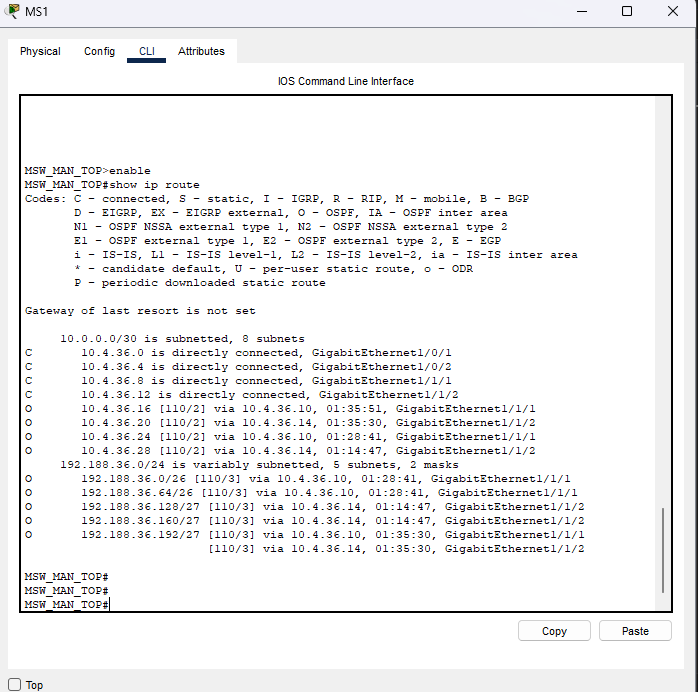

---

## 5. Agregación de Enlaces — EtherChannel

EtherChannel combina múltiples interfaces físicas en un único enlace lógico, aumentando el ancho de banda y proporcionando redundancia automática. Si un enlace físico falla, el tráfico se redistribuye entre los restantes sin interrupción del servicio.

### 5.1 LACP — IEEE 802.3ad (Edificio Izquierdo)

**LACP (Link Aggregation Control Protocol)** es un estándar abierto (IEEE) que negocia la formación del bundle mediante mensajes PDU. El modo `active` envía LACPDUs proactivamente; el modo `passive` solo responde.

**Topología de Port-Channels en Edificio Izquierdo:**

```
  MSW_CORE_IZQ
   Fa0/1-Fa0/2 ====== Po1 ====== Fa0/1-Fa0/2  MSW_DIST_IZQ
   Fa0/3-Fa0/4 ====== Po2 ====== Fa0/3-Fa0/4  MSW_DIST_IZQ
                                 Fa0/5-Fa0/6 == Po3 == Fa0/1-Fa0/2  SW1_ACCESO_IZQ
                                 Fa0/7-Fa0/8 == Po3 == Fa0/1-Fa0/2  SW2_ACCESO_IZQ
```

| Port-Channel | Dispositivos | Interfaces Físicas | Modo |
|---|---|---|---|
| **Po1** | CORE_IZQ <-> DIST_IZQ | Fa0/1, Fa0/2 | `active` <-> `active` |
| **Po2** | CORE_IZQ <-> DIST_IZQ | Fa0/3, Fa0/4 | `active` <-> `active` |
| **Po3** | DIST_IZQ <-> SW1/SW2 | Fa0/5-Fa0/8 | `active` <-> `active` |

### 5.2 PAgP — Port Aggregation Protocol (Edificio Derecho)

**PAgP** es un protocolo propietario de Cisco. El modo `desirable` negocia activamente; el modo `auto` solo responde a solicitudes del otro extremo. Para que el bundle se forme, al menos un extremo debe estar en `desirable`.

| Port-Channel | Dispositivos | Modo Extremo A | Modo Extremo B |
|---|---|---|---|
| **Po10** | CORE_DER <-> DIST_DER | `desirable` | `desirable` |
| **Po20** | DIST_DER <-> SW3_ACC_DER | `desirable` | `auto` |

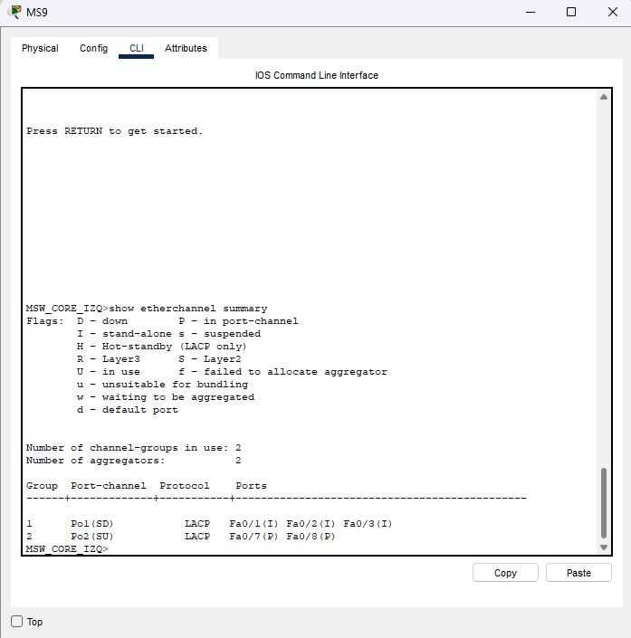

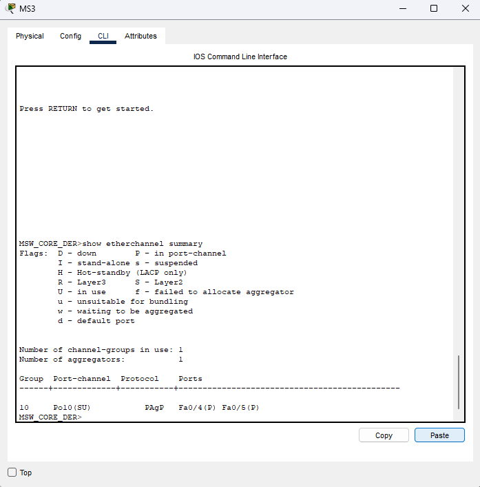

---

## 6. Enrutamiento Dinámico OSPFv2

### 6.1 Por Qué OSPFv2

La terminación de carné **36** es **PAR**, lo que determina el uso de **OSPFv2 (Open Shortest Path First versión 2)**. OSPF es un protocolo de enrutamiento de estado de enlace (Link-State) que:

- Construye un mapa completo de la topología mediante el algoritmo SPF de Dijkstra.
- Converge rápidamente ante cambios en la red.
- Soporta VLSM y CIDR de forma nativa.
- Escala eficientemente en redes medianas y grandes.
- Utiliza multicast `224.0.0.5` (AllSPFRouters) y `224.0.0.6` (AllDRRouters) para intercambio de LSAs.

### 6.2 Área OSPF y Router-IDs

Toda la red opera en el **Área 0 (Backbone)**. El Área 0 es obligatoria en OSPF y todas las demás áreas deben conectarse a ella.

| Dispositivo | Router-ID | Redes Anunciadas |
|---|---|---|
| `MSW_MAN_TOP` | `1.1.1.1` | `10.4.36.0/30`, `10.4.36.4/30`, `10.4.36.8/30`, `10.4.36.12/30` |
| `MSW_MAN_LEFT` | `2.2.2.2` | `10.4.36.8/30`, `10.4.36.16/30`, `10.4.36.24/30` |
| `MSW_MAN_RIGHT` | `3.3.3.3` | `10.4.36.12/30`, `10.4.36.20/30`, `10.4.36.28/30` |
| `MSW_MAN_ADMIN` | `4.4.4.4` | `10.4.36.16/30`, `10.4.36.20/30`, `192.188.36.192/27` |
| `MSW_CORE_IZQ` | `5.5.5.5` | `10.4.36.24/30`, `192.188.36.0/26`, `192.188.36.64/26` |
| `MSW_CORE_DER` | `6.6.6.6` | `10.4.36.28/30`, `192.188.36.128/27`, `192.188.36.160/27` |

### 6.3 Diagrama de Adyacencias OSPF

```
[MSW_CORE_IZQ]------[MSW_MAN_LEFT]------[MSW_MAN_TOP]------[MSW_MAN_RIGHT]------[MSW_CORE_DER]
 RID 5.5.5.5  .26/.25  RID 2.2.2.2 .10/.9 RID 1.1.1.1 .14/.13 RID 3.3.3.3 .30/.29 RID 6.6.6.6
                              |                     |
                          .18/.17               .22/.21
                              |                     |
                         [MSW_MAN_ADMIN RID 4.4.4.4]
                                    |
                                 PC0 (VLAN 99)
```

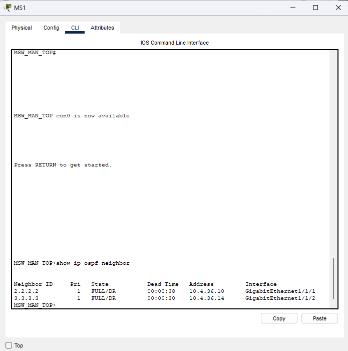

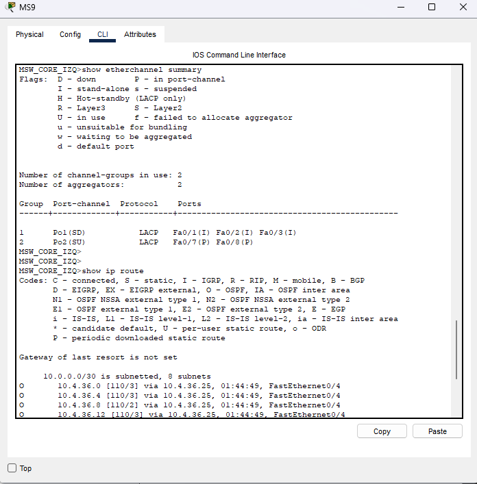
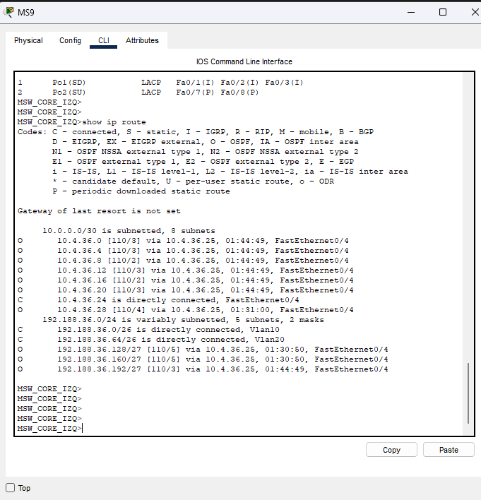

---

## 7. Servicios DHCP Centralizado y Relay

### 7.1 Arquitectura del Servicio DHCP

Los servidores DHCP se ubican centralmente en la MAN, conectados al `MSW_MAN_TOP`. Esto permite una administración centralizada de los pools de direcciones. Los Switches Core de cada edificio actúan como **DHCP Relay Agents**.

```
  [DHCP1]-10.4.36.2-[MSW_MAN_TOP]-10.4.36.9-[MSW_MAN_LEFT]-10.4.36.25-[MSW_CORE_IZQ]
                                                                              |
                                                            ip helper-address 10.4.36.2
                                                                          (VLAN 10 y 20)

  [DHCP2]-10.4.36.6-[MSW_MAN_TOP]-10.4.36.13-[MSW_MAN_RIGHT]-10.4.36.29-[MSW_CORE_DER]
                                                                               |
                                                             ip helper-address 10.4.36.6
                                                                           (VLAN 30 y 40)
```

### 7.2 Configuración de los Servidores DHCP

#### Server DHCP1 — Edificio Izquierdo

| Parámetro | Valor |
|---|---|
| **IP del Servidor** | `10.4.36.2` |
| **Máscara** | `255.255.255.252` |
| **Gateway del Servidor** | `10.4.36.1` |

| Pool | Gateway | Start IP | Máscara |
|---|---|---|---|
| `POOL_NARANJA_IZQ` | `192.188.36.1` | `192.188.36.2` | `255.255.255.192` |
| `POOL_VERDE_IZQ` | `192.188.36.65` | `192.188.36.66` | `255.255.255.192` |

#### Server DHCP2 — Edificio Derecho

| Parámetro | Valor |
|---|---|
| **IP del Servidor** | `10.4.36.6` |
| **Máscara** | `255.255.255.252` |
| **Gateway del Servidor** | `10.4.36.5` |

| Pool | Gateway | Start IP | Máscara |
|---|---|---|---|
| `POOL_NARANJA_DER` | `192.188.36.129` | `192.188.36.130` | `255.255.255.224` |
| `POOL_VERDE_DER` | `192.188.36.161` | `192.188.36.162` | `255.255.255.224` |

### 7.3 DHCP Relay — `ip helper-address`

Cuando un host en VLAN 10 hace un broadcast DHCP (`255.255.255.255`), el broadcast no puede cruzar un router. El comando `ip helper-address` en la SVI del Core **convierte** ese broadcast en un **unicast** dirigido al servidor DHCP real, permitiendo el servicio centralizado.

**Flujo del proceso DHCP con Relay:**

```
  [PC Host]--DHCP Discover (broadcast)-->[SVI VLAN10 en CORE_IZQ]
                                              |
                                    ip helper-address -> reenvía como
                                    unicast a 10.4.36.2 (DHCP1)
                                              |
                                         [DHCP1]--DHCP Offer-->[PC Host]
```

---

## 8. Políticas de Seguridad — Listas de Control de Acceso (ACLs)

### 8.1 Filosofía de Diseño

Las ACLs implementadas son de tipo **Extendidas**, lo que permite filtrar tráfico basado en:
- Dirección IP de origen y destino
- Protocolo (IP, TCP, UDP, ICMP)
- Puertos de origen y destino (para TCP/UDP)

**Puntos de aplicación:** Las ACLs se aplican en dirección **`in`** en las **SVIs (interfaces virtuales)** de los switches Core de capa 3 (`MSW_CORE_IZQ` y `MSW_CORE_DER`). Esto significa que el tráfico es evaluado **al entrar** al router desde la VLAN correspondiente.

> **Ventaja de aplicar ACL `in` en la SVI:** El tráfico denegado es descartado antes de ser procesado por la tabla de enrutamiento, ahorrando recursos del procesador.

### 8.2 Matriz de Políticas de Acceso

La tabla define qué comunicaciones están **permitidas** o **denegadas** entre VLANs:

| Origen \ Destino | VLAN 10 Naranja IZQ | VLAN 20 Verde IZQ | VLAN 30 Naranja DER | VLAN 40 Verde DER | VLAN 99 ADMIN |
|---|---|---|---|---|---|
| **VLAN 10 Naranja IZQ** | Permitido (misma) | DENEGADO | Permitido | DENEGADO | Bloqueado inicio |
| **VLAN 20 Verde IZQ** | DENEGADO | Permitido (misma) | DENEGADO | Permitido | Bloqueado inicio |
| **VLAN 30 Naranja DER** | Permitido | DENEGADO | Permitido (misma) | DENEGADO | Bloqueado inicio |
| **VLAN 40 Verde DER** | DENEGADO | Permitido | DENEGADO | Permitido (misma) | Bloqueado inicio |
| **VLAN 99 ADMIN** | Permitido total | Permitido total | Permitido total | Permitido total | Permitido total |

> `Bloqueado inicio` = Las VLANs de usuario pueden recibir respuestas de ADMIN (TCP established / ICMP reply), pero **no pueden iniciar** conexiones nuevas hacia ADMIN.

### 8.3 Lógica de las ACLs Detallada

#### ACL para VLAN Naranja (aplicada en vlan 10 y vlan 30)

```
! -------------------------------------------------------------------
! ACL_NARANJA_IZQ - aplicada en: interface vlan 10 (MSW_CORE_IZQ) in
! -------------------------------------------------------------------
ip access-list extended ACL_NARANJA_IZQ

 ! REGLA 1: Permitir comunicacion SOLO con VLAN Naranja del edificio
 ! REMOTO (VLAN 30). Se permite trafico IP completo entre las dos
 ! VLANs naranja (homologas)
 permit ip 192.188.36.0 0.0.0.63 192.188.36.128 0.0.0.31
 permit ip 192.188.36.128 0.0.0.31 192.188.36.0 0.0.0.63

 ! REGLA 2: Permitir broadcasts UDP de DHCP
 ! bootps = puerto 67 (servidor), bootpc = puerto 68 (cliente)
 ! Necesario para que los hosts puedan obtener IP del servidor DHCP
 permit udp 192.188.36.0 0.0.0.63 host 255.255.255.255 eq bootps
 permit udp 192.188.36.0 0.0.0.63 host 255.255.255.255 eq bootpc

 ! REGLA 3: Permitir respuestas ICMP (echo-reply) desde ADMIN
 ! Esto permite que PC0 (ADMIN) haga ping y reciba respuesta
 permit icmp 192.188.36.192 0.0.0.31 192.188.36.0 0.0.0.63 echo-reply

 ! REGLA 3b: Permitir sesiones TCP ya establecidas desde ADMIN
 ! "established" = el bit ACK esta en 1, sesion iniciada por ADMIN
 permit tcp 192.188.36.192 0.0.0.31 192.188.36.0 0.0.0.63 established

 ! REGLA 4: DENEGAR trafic hacia VLAN Verde IZQ
 deny ip 192.188.36.0 0.0.0.63 192.188.36.64 0.0.0.63

 ! REGLA 5: DENEGAR trafico hacia VLAN Verde DER
 deny ip 192.188.36.0 0.0.0.63 192.188.36.160 0.0.0.31

 ! REGLA 6: DENEGAR trafico INICIADO hacia VLAN ADMIN
 deny ip 192.188.36.0 0.0.0.63 192.188.36.192 0.0.0.31

 ! REGLA IMPLICITA FINAL: deny ip any any (todo lo demas es denegado)
```

#### ACL para VLAN Verde (aplicada en vlan 20 y vlan 40)

```
! -------------------------------------------------------------------
! ACL_VERDE_IZQ - aplicada en: interface vlan 20 (MSW_CORE_IZQ) in
! -------------------------------------------------------------------
ip access-list extended ACL_VERDE_IZQ

 ! REGLA 1: Permitir comunicacion completa con VLAN Verde del edificio
 ! REMOTO (VLAN 40)
 permit ip 192.188.36.64 0.0.0.63 192.188.36.160 0.0.0.31
 permit ip 192.188.36.160 0.0.0.31 192.188.36.64 0.0.0.63

 ! REGLA 2: Permitir broadcasts UDP de DHCP
 permit udp 192.188.36.64 0.0.0.63 host 255.255.255.255 eq bootps
 permit udp 192.188.36.64 0.0.0.63 host 255.255.255.255 eq bootpc

 ! REGLA 3: Permitir respuestas ICMP y TCP establecidas desde ADMIN
 permit icmp 192.188.36.192 0.0.0.31 192.188.36.64 0.0.0.63 echo-reply
 permit tcp 192.188.36.192 0.0.0.31 192.188.36.64 0.0.0.63 established

 ! REGLA 4: DENEGAR trafico hacia VLAN Naranja IZQ
 deny ip 192.188.36.64 0.0.0.63 192.188.36.0 0.0.0.63

 ! REGLA 5: DENEGAR trafico hacia VLAN Naranja DER
 deny ip 192.188.36.64 0.0.0.63 192.188.36.128 0.0.0.31

 ! REGLA 6: DENEGAR trafico iniciado hacia VLAN ADMIN
 deny ip 192.188.36.64 0.0.0.63 192.188.36.192 0.0.0.31

 ! REGLA IMPLICITA: deny ip any any
```

> **Explicación de `established`:** Este keyword en una regla ACL de TCP solo permite paquetes cuyo flag `ACK` esté activo, es decir, pertenecen a una conexión TCP que ya fue **iniciada** (el SYN inicial no tiene ACK). Esto permite que ADMIN inicie conexiones y reciba respuestas, pero impide que las VLANs de usuario inicien nuevas conexiones TCP hacia ADMIN.

---

## 9. Configuraciones Completas por Dispositivo

### 9.1 MSW_MAN_TOP

```cisco
! ===================================================
! DISPOSITIVO: MSW_MAN_TOP
! ROL: Switch Core de la MAN / Gateway hacia servidores DHCP
! MODELO: Cisco Catalyst 3650
! ROUTER-ID OSPF: 1.1.1.1
! ===================================================

! --- Nombre del dispositivo ---
hostname MSW_MAN_TOP

! --- Desactivar busqueda DNS (evita delays por typos) ---
no ip domain-lookup

! --- Habilitar enrutamiento IP de capa 3 ---
! Sin este comando, el switch opera solo en L2
ip routing

! --- INTERFAZ hacia DHCP1 ---
interface GigabitEthernet1/0/1
 description ENLACE_A_DHCP1
 ! "no switchport" convierte la interfaz de L2 a L3 (interfaz enrutada)
 ! Esto es necesario para asignarle una direccion IP directamente
 no switchport
 ip address 10.4.36.1 255.255.255.252
 no shutdown

! --- INTERFAZ hacia DHCP2 ---
interface GigabitEthernet1/0/2
 description ENLACE_A_DHCP2
 no switchport
 ip address 10.4.36.5 255.255.255.252
 no shutdown

! --- ENLACE ANILLO MAN hacia MSW_MAN_LEFT ---
interface GigabitEthernet1/1/1
 description ANILLO_MAN_HACIA_LEFT
 no switchport
 ip address 10.4.36.9 255.255.255.252
 no shutdown

! --- ENLACE ANILLO MAN hacia MSW_MAN_RIGHT ---
interface GigabitEthernet1/1/2
 description ANILLO_MAN_HACIA_RIGHT
 no switchport
 ip address 10.4.36.13 255.255.255.252
 no shutdown

! --- CONFIGURACION OSPF ---
router ospf 1
 ! Router-ID unico en la red OSPF, identifica este dispositivo
 router-id 1.1.1.1
 ! Se anuncia cada red directamente conectada en Area 0 (Backbone)
 ! Wildcard = inverso de la mascara: /30 -> wildcard 0.0.0.3
 network 10.4.36.0 0.0.0.3 area 0
 network 10.4.36.4 0.0.0.3 area 0
 network 10.4.36.8 0.0.0.3 area 0
 network 10.4.36.12 0.0.0.3 area 0
```

---

### 9.2 MSW_MAN_LEFT

```cisco
! ===================================================
! DISPOSITIVO: MSW_MAN_LEFT
! ROL: Demarcacion hacia Edificio Izquierdo
! ROUTER-ID OSPF: 2.2.2.2
! ===================================================

hostname MSW_MAN_LEFT
no ip domain-lookup
ip routing

! --- ENLACE ANILLO MAN hacia MSW_MAN_TOP ---
interface GigabitEthernet1/1/2
 description ANILLO_MAN_HACIA_TOP
 no switchport
 ip address 10.4.36.10 255.255.255.252
 no shutdown

! --- ENLACE ANILLO MAN hacia MSW_MAN_ADMIN ---
interface GigabitEthernet1/1/1
 description ANILLO_MAN_HACIA_ADMIN
 no switchport
 ip address 10.4.36.17 255.255.255.252
 no shutdown

! --- ENLACE WAN hacia MSW_CORE_IZQ ---
interface GigabitEthernet1/0/4
 description ENLACE_A_CORE_IZQ
 no switchport
 ip address 10.4.36.25 255.255.255.252
 no shutdown

! --- CONFIGURACION OSPF ---
router ospf 1
 router-id 2.2.2.2
 network 10.4.36.8 0.0.0.3 area 0
 network 10.4.36.16 0.0.0.3 area 0
 network 10.4.36.24 0.0.0.3 area 0
```

---

### 9.3 MSW_MAN_RIGHT

```cisco
! ===================================================
! DISPOSITIVO: MSW_MAN_RIGHT
! ROL: Demarcacion hacia Edificio Derecho
! ROUTER-ID OSPF: 3.3.3.3
! ===================================================

hostname MSW_MAN_RIGHT
no ip domain-lookup
ip routing

! --- ENLACE ANILLO MAN hacia MSW_MAN_TOP ---
interface GigabitEthernet1/1/1
 description ANILLO_MAN_HACIA_TOP
 no switchport
 ip address 10.4.36.14 255.255.255.252
 no shutdown

! --- ENLACE ANILLO MAN hacia MSW_MAN_ADMIN ---
interface GigabitEthernet1/1/2
 description ANILLO_MAN_HACIA_ADMIN
 no switchport
 ip address 10.4.36.21 255.255.255.252
 no shutdown

! --- ENLACE WAN hacia MSW_CORE_DER ---
interface GigabitEthernet1/0/1
 description ENLACE_A_CORE_DER
 no switchport
 ip address 10.4.36.29 255.255.255.252
 no shutdown

! --- CONFIGURACION OSPF ---
router ospf 1
 router-id 3.3.3.3
 network 10.4.36.12 0.0.0.3 area 0
 network 10.4.36.20 0.0.0.3 area 0
 network 10.4.36.28 0.0.0.3 area 0
```

---

### 9.4 MSW_MAN_ADMIN

```cisco
! ===================================================
! DISPOSITIVO: MSW_MAN_ADMIN
! ROL: Gateway de VLAN ADMIN / Cierre del anillo MAN
! ROUTER-ID OSPF: 4.4.4.4
! ===================================================

hostname MSW_MAN_ADMIN
no ip domain-lookup
ip routing

! --- ENLACE ANILLO MAN hacia MSW_MAN_LEFT ---
interface GigabitEthernet1/1/2
 description ANILLO_MAN_HACIA_LEFT
 no switchport
 ip address 10.4.36.18 255.255.255.252
 no shutdown

! --- ENLACE ANILLO MAN hacia MSW_MAN_RIGHT ---
interface GigabitEthernet1/1/1
 description ANILLO_MAN_HACIA_RIGHT
 no switchport
 ip address 10.4.36.22 255.255.255.252
 no shutdown

! --- VTP y VLAN ADMIN ---
vtp domain CHAPINRED_202201336
vtp mode server
vtp version 2

vlan 99
 name VLAN_ADMIN_EdificioADMIN_202201336

! --- INTERFAZ DE ACCESO hacia PC0 ---
interface FastEthernet0/1
 description PC0_ADMIN
 switchport mode access
 switchport access vlan 99
 no shutdown

! --- SVI VLAN 99 (Gateway para PC0) ---
interface vlan 99
 description SVI_VLAN_ADMIN
 ip address 192.188.36.193 255.255.255.224
 no shutdown

! --- CONFIGURACION OSPF ---
router ospf 1
 router-id 4.4.4.4
 network 10.4.36.16 0.0.0.3 area 0
 network 10.4.36.20 0.0.0.3 area 0
 ! Se anuncia la red de la VLAN ADMIN para que sea alcanzable
 network 192.188.36.192 0.0.0.31 area 0
```

---

### 9.5 MSW_CORE_IZQ

```cisco
! ===================================================
! DISPOSITIVO: MSW_CORE_IZQ
! ROL: Core L3 del Edificio Izquierdo
! MODELO: Cisco Catalyst 3560
! ROUTER-ID OSPF: 5.5.5.5
! ===================================================

hostname MSW_CORE_IZQ
no ip domain-lookup
ip routing

! --- VTP ---
vtp domain CHAPINRED_202201336
vtp mode server
vtp version 2

! --- DEFINICION DE VLANs ---
vlan 10
 name VLAN_Naranja_EdificioIZQ_202201336
vlan 20
 name VLAN_Verde_EdificioIZQ_202201336

! --- ENLACE L3 HACIA LA MAN ---
interface FastEthernet0/4
 description ENLACE_L3_HACIA_MAN_LEFT
 no switchport
 ip address 10.4.36.26 255.255.255.252
 no shutdown

! --- LACP PORT-CHANNEL 1 (hacia MSW_DIST_IZQ) ---
! Primero se configuran las interfaces fisicas miembro del bundle
interface range FastEthernet0/1 - 2
 description PO1_HACIA_DIST_IZQ
 ! Modo trunk necesario para transportar multiples VLANs
 switchport mode trunk
 ! channel-group: asigna la interfaz al Port-Channel indicado
 ! mode active: envia LACPDUs proactivamente (IEEE 802.3ad)
 channel-group 1 mode active
 no shutdown

! --- LACP PORT-CHANNEL 2 (hacia MSW_DIST_IZQ backup) ---
interface range FastEthernet0/3 - 4
 description PO2_HACIA_DIST_IZQ
 switchport mode trunk
 channel-group 2 mode active
 no shutdown

! --- INTERFAZ LOGICA PORT-CHANNEL 1 ---
interface Port-channel1
 description LACP_PO1_A_DIST_IZQ
 switchport mode trunk
 ! Se permiten solo las VLANs necesarias en el trunk
 switchport trunk allowed vlan 10,20

! --- INTERFAZ LOGICA PORT-CHANNEL 2 ---
interface Port-channel2
 description LACP_PO2_A_DIST_IZQ
 switchport mode trunk
 switchport trunk allowed vlan 10,20

! --- SVIs - SWITCHED VIRTUAL INTERFACES ---
! La SVI es la interfaz de capa 3 que actua como Default Gateway
! para todos los hosts en esa VLAN

interface vlan 10
 description SVI_VLAN_NARANJA_IZQ
 ip address 192.188.36.1 255.255.255.192
 ! DHCP Relay: convierte el broadcast DHCP del host en unicast al servidor
 ip helper-address 10.4.36.2
 ! Aplicar la ACL en direccion entrante (trafico que viene de los hosts)
 ip access-group ACL_NARANJA_IZQ in
 no shutdown

interface vlan 20
 description SVI_VLAN_VERDE_IZQ
 ip address 192.188.36.65 255.255.255.192
 ip helper-address 10.4.36.2
 ip access-group ACL_VERDE_IZQ in
 no shutdown

! --- ACLs EXTENDIDAS ---
ip access-list extended ACL_NARANJA_IZQ
 permit ip 192.188.36.0 0.0.0.63 192.188.36.128 0.0.0.31
 permit ip 192.188.36.128 0.0.0.31 192.188.36.0 0.0.0.63
 permit udp 192.188.36.0 0.0.0.63 host 255.255.255.255 eq bootps
 permit udp 192.188.36.0 0.0.0.63 host 255.255.255.255 eq bootpc
 permit icmp 192.188.36.192 0.0.0.31 192.188.36.0 0.0.0.63 echo-reply
 permit tcp 192.188.36.192 0.0.0.31 192.188.36.0 0.0.0.63 established
 deny ip 192.188.36.0 0.0.0.63 192.188.36.64 0.0.0.63
 deny ip 192.188.36.0 0.0.0.63 192.188.36.160 0.0.0.31
 deny ip 192.188.36.0 0.0.0.63 192.188.36.192 0.0.0.31

ip access-list extended ACL_VERDE_IZQ
 permit ip 192.188.36.64 0.0.0.63 192.188.36.160 0.0.0.31
 permit ip 192.188.36.160 0.0.0.31 192.188.36.64 0.0.0.63
 permit udp 192.188.36.64 0.0.0.63 host 255.255.255.255 eq bootps
 permit udp 192.188.36.64 0.0.0.63 host 255.255.255.255 eq bootpc
 permit icmp 192.188.36.192 0.0.0.31 192.188.36.64 0.0.0.63 echo-reply
 permit tcp 192.188.36.192 0.0.0.31 192.188.36.64 0.0.0.63 established
 deny ip 192.188.36.64 0.0.0.63 192.188.36.0 0.0.0.63
 deny ip 192.188.36.64 0.0.0.63 192.188.36.128 0.0.0.31
 deny ip 192.188.36.64 0.0.0.63 192.188.36.192 0.0.0.31

! --- OSPF ---
router ospf 1
 router-id 5.5.5.5
 network 10.4.36.24 0.0.0.3 area 0
 ! Se anuncian las redes de las SVIs para que los hosts sean alcanzables
 network 192.188.36.0 0.0.0.63 area 0
 network 192.188.36.64 0.0.0.63 area 0
```

---

### 9.6 MSW_DIST_IZQ

```cisco
! ===================================================
! DISPOSITIVO: MSW_DIST_IZQ
! ROL: Distribucion L2 del Edificio Izquierdo
! MODELO: Cisco Catalyst 3560
! ===================================================

hostname MSW_DIST_IZQ
no ip domain-lookup

! --- VTP: modo client, recibe VLANs del servidor ---
vtp domain CHAPINRED_202201336
vtp mode client
vtp version 2

! --- LACP PORT-CHANNEL 1 (hacia MSW_CORE_IZQ) ---
interface range FastEthernet0/1 - 2
 description PO1_HACIA_CORE_IZQ
 switchport mode trunk
 channel-group 1 mode active
 no shutdown

! --- LACP PORT-CHANNEL 2 (hacia MSW_CORE_IZQ backup) ---
interface range FastEthernet0/3 - 4
 description PO2_HACIA_CORE_IZQ
 switchport mode trunk
 channel-group 2 mode active
 no shutdown

! --- LACP PORT-CHANNEL 3 (hacia switches de Acceso) ---
interface range FastEthernet0/5 - 8
 description PO3_HACIA_ACCESO
 switchport mode trunk
 channel-group 3 mode active
 no shutdown

interface Port-channel1
 switchport mode trunk
 switchport trunk allowed vlan 10,20

interface Port-channel2
 switchport mode trunk
 switchport trunk allowed vlan 10,20

interface Port-channel3
 switchport mode trunk
 switchport trunk allowed vlan 10,20
```

---

### 9.7 SW1_ACCESO_IZQ y SW2_ACCESO_IZQ

```cisco
! ===================================================
! DISPOSITIVO: SW1_ACCESO_IZQ (configuracion igual para SW2)
! ROL: Acceso L2 del Edificio Izquierdo
! MODELO: Cisco Catalyst 2960
! ===================================================

hostname SW1_ACCESO_IZQ
no ip domain-lookup

! --- VTP cliente (recibe VLANs del servidor) ---
vtp domain CHAPINRED_202201336
vtp mode client
vtp version 2

! --- LACP hacia MSW_DIST_IZQ ---
interface range FastEthernet0/1 - 2
 description PO1_HACIA_DIST_IZQ
 switchport mode trunk
 channel-group 1 mode active
 no shutdown

interface Port-channel1
 switchport mode trunk
 switchport trunk allowed vlan 10,20

! --- PUERTOS DE ACCESO PARA HOSTS ---
! Puertos de VLAN Naranja (VLAN 10)
interface range FastEthernet0/3 - 12
 description ACCESO_VLAN_NARANJA
 switchport mode access
 switchport access vlan 10
 ! spanning-tree portfast: activa el puerto inmediatamente sin pasar
 ! por los estados de STP (ahorra hasta 30 segundos de espera)
 spanning-tree portfast
 no shutdown

! Puertos de VLAN Verde (VLAN 20)
interface range FastEthernet0/13 - 24
 description ACCESO_VLAN_VERDE
 switchport mode access
 switchport access vlan 20
 spanning-tree portfast
 no shutdown
```

---

### 9.8 MSW_CORE_DER

```cisco
! ===================================================
! DISPOSITIVO: MSW_CORE_DER
! ROL: Core L3 del Edificio Derecho
! MODELO: Cisco Catalyst 3560
! ROUTER-ID OSPF: 6.6.6.6
! ===================================================

hostname MSW_CORE_DER
no ip domain-lookup
ip routing

! --- VTP ---
vtp domain CHAPINRED_202201336
vtp mode server
vtp version 2

vlan 30
 name VLAN_Naranja_EdificioDER_202201336
vlan 40
 name VLAN_Verde_EdificioDER_202201336

! --- ENLACE L3 HACIA LA MAN ---
interface FastEthernet0/1
 description ENLACE_L3_HACIA_MAN_RIGHT
 no switchport
 ip address 10.4.36.30 255.255.255.252
 no shutdown

! --- PAgP PORT-CHANNEL 10 (hacia MSW_DIST_DER) ---
interface range FastEthernet0/2 - 3
 description PO10_HACIA_DIST_DER
 switchport mode trunk
 ! mode desirable: negocia activamente el EtherChannel con PAgP
 channel-group 10 mode desirable
 no shutdown

interface Port-channel10
 description PAGP_PO10_A_DIST_DER
 switchport mode trunk
 switchport trunk allowed vlan 30,40

! --- SVIs VLAN 30 y VLAN 40 ---
interface vlan 30
 description SVI_VLAN_NARANJA_DER
 ip address 192.188.36.129 255.255.255.224
 ip helper-address 10.4.36.6
 ip access-group ACL_NARANJA_DER in
 no shutdown

interface vlan 40
 description SVI_VLAN_VERDE_DER
 ip address 192.188.36.161 255.255.255.224
 ip helper-address 10.4.36.6
 ip access-group ACL_VERDE_DER in
 no shutdown

! --- ACLs EXTENDIDAS ---
ip access-list extended ACL_NARANJA_DER
 permit ip 192.188.36.128 0.0.0.31 192.188.36.0 0.0.0.63
 permit ip 192.188.36.0 0.0.0.63 192.188.36.128 0.0.0.31
 permit udp 192.188.36.128 0.0.0.31 host 255.255.255.255 eq bootps
 permit udp 192.188.36.128 0.0.0.31 host 255.255.255.255 eq bootpc
 permit icmp 192.188.36.192 0.0.0.31 192.188.36.128 0.0.0.31 echo-reply
 permit tcp 192.188.36.192 0.0.0.31 192.188.36.128 0.0.0.31 established
 deny ip 192.188.36.128 0.0.0.31 192.188.36.160 0.0.0.31
 deny ip 192.188.36.128 0.0.0.31 192.188.36.64 0.0.0.63
 deny ip 192.188.36.128 0.0.0.31 192.188.36.192 0.0.0.31

ip access-list extended ACL_VERDE_DER
 permit ip 192.188.36.160 0.0.0.31 192.188.36.64 0.0.0.63
 permit ip 192.188.36.64 0.0.0.63 192.188.36.160 0.0.0.31
 permit udp 192.188.36.160 0.0.0.31 host 255.255.255.255 eq bootps
 permit udp 192.188.36.160 0.0.0.31 host 255.255.255.255 eq bootpc
 permit icmp 192.188.36.192 0.0.0.31 192.188.36.160 0.0.0.31 echo-reply
 permit tcp 192.188.36.192 0.0.0.31 192.188.36.160 0.0.0.31 established
 deny ip 192.188.36.160 0.0.0.31 192.188.36.128 0.0.0.31
 deny ip 192.188.36.160 0.0.0.31 192.188.36.0 0.0.0.63
 deny ip 192.188.36.160 0.0.0.31 192.188.36.192 0.0.0.31

! --- OSPF ---
router ospf 1
 router-id 6.6.6.6
 network 10.4.36.28 0.0.0.3 area 0
 network 192.188.36.128 0.0.0.31 area 0
 network 192.188.36.160 0.0.0.31 area 0
```

---

### 9.9 MSW_DIST_DER y Switches de Acceso (Edificio Derecho)

```cisco
! ===================================================
! DISPOSITIVO: MSW_DIST_DER
! ROL: Distribucion L2 del Edificio Derecho
! ===================================================

hostname MSW_DIST_DER
no ip domain-lookup
vtp domain CHAPINRED_202201336
vtp mode client
vtp version 2

! --- PAgP PORT-CHANNEL 10 (hacia CORE_DER) ---
interface range FastEthernet0/1 - 2
 description PO10_HACIA_CORE_DER
 switchport mode trunk
 ! En el extremo receptor tambien se usa desirable para asegurar
 ! la negociacion bidireccional de PAgP
 channel-group 10 mode desirable
 no shutdown

! --- PAgP PORT-CHANNEL 20 (hacia SW3_ACCESO_DER) ---
interface range FastEthernet0/3 - 4
 description PO20_HACIA_SW3_ACCESO
 switchport mode trunk
 channel-group 20 mode desirable
 no shutdown

interface Port-channel10
 switchport mode trunk
 switchport trunk allowed vlan 30,40

interface Port-channel20
 switchport mode trunk
 switchport trunk allowed vlan 30,40

! ---------------------------------------------------
! DISPOSITIVO: SW3_ACCESO_DER
! ROL: Acceso L2 del Edificio Derecho
! ---------------------------------------------------

hostname SW3_ACCESO_DER
vtp domain CHAPINRED_202201336
vtp mode client

! --- PAgP hacia MSW_DIST_DER (modo auto = solo responde) ---
interface range FastEthernet0/1 - 2
 switchport mode trunk
 ! mode auto: acepta negociacion PAgP iniciada por el otro extremo
 ! Para formar el bundle, el otro extremo (DIST_DER) debe ser desirable
 channel-group 20 mode auto
 no shutdown

interface Port-channel20
 switchport mode trunk
 switchport trunk allowed vlan 30,40

! Puertos de acceso para hosts
interface range FastEthernet0/3 - 13
 switchport mode access
 switchport access vlan 30
 spanning-tree portfast
 no shutdown

interface range FastEthernet0/14 - 24
 switchport mode access
 switchport access vlan 40
 spanning-tree portfast
 no shutdown
```

---

## 10. Protocolo de Pruebas y Verificación

### 10.1 Comandos de Verificación Esenciales

Antes de ejecutar las pruebas funcionales, se verificó el estado correcto de cada componente:

```cisco
! --- Verificacion de EtherChannel ---
show etherchannel summary
! Salida esperada: Po1(SU) -> S=Layer2, U=In use (bundled)
! Banderas de las interfaces: P=bundled in port-channel

show etherchannel detail
! Muestra detalles del protocolo (LACP/PAgP), velocidades y estados

! --- Verificacion OSPF ---
show ip ospf neighbor
! Muestra vecinos OSPF: estado debe ser FULL para todos

show ip ospf database
! Muestra la base de datos de estado de enlace (LSDB)

show ip route ospf
! Muestra solo las rutas aprendidas por OSPF (marcadas con "O")

! --- Verificacion de VLANs y VTP ---
show vlan brief
! Lista todas las VLANs activas y los puertos asignados a cada una

show vtp status
! Muestra: dominio, modo (server/client), numero de revision, VLANs

show interfaces trunk
! Lista todas las interfaces en modo trunk y las VLANs permitidas

! --- Verificacion de ACLs ---
show ip access-lists
! Muestra todas las ACLs con el contador de matches por regla

show ip interface vlan 10
! Muestra que ACLs estan aplicadas en la SVI (inbound/outbound)
```

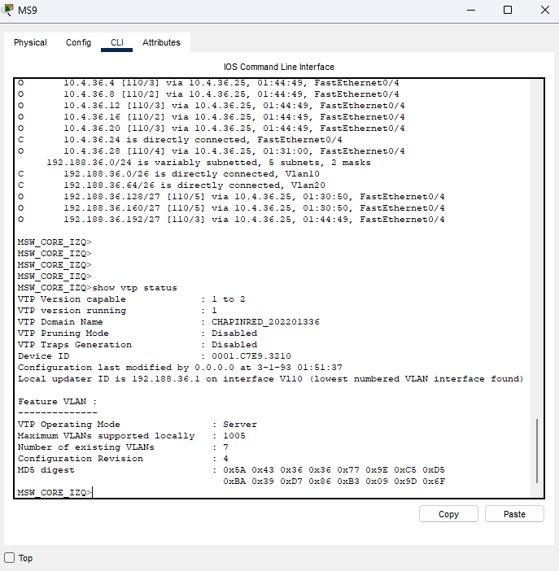

### 10.2 Matriz de Pruebas de Conectividad

#### PRUEBA 1 — Conectividad Homologa VLAN Verde

| Campo | Detalle |
|---|---|
| **Descripcion** | Ping entre hosts de VLAN Verde de ambos edificios |
| **Origen** | PC2 — VLAN 20 (IZQ) — IP: `192.188.36.66` |
| **Destino** | Laptop2 — VLAN 40 (DER) — IP: `192.188.36.164` |
| **Protocolo** | ICMP Echo / Echo-Reply |
| **Ruta** | PC2 -> CORE_IZQ -> MAN_LEFT -> MAN_TOP -> MAN_RIGHT -> CORE_DER -> Laptop2 |
| **Resultado** | **EXITOSO** — 0% de perdida de paquetes tras convergencia ARP |

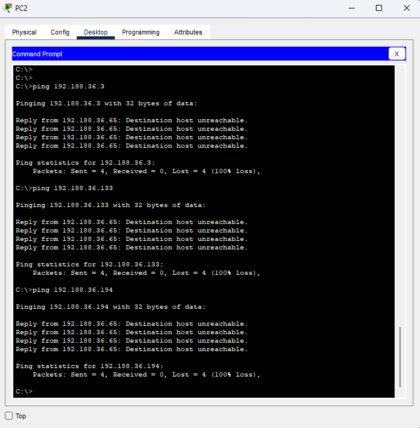

---

#### PRUEBA 2 — Conectividad Homologa VLAN Naranja

| Campo | Detalle |
|---|---|
| **Descripcion** | Ping entre hosts de VLAN Naranja de ambos edificios |
| **Origen** | PC1 — VLAN 10 (IZQ) — IP: `192.188.36.3` |
| **Destino** | PC3 — VLAN 30 (DER) — IP: `192.188.36.133` |
| **Resultado** | **EXITOSO** — Conectividad estable y continua |

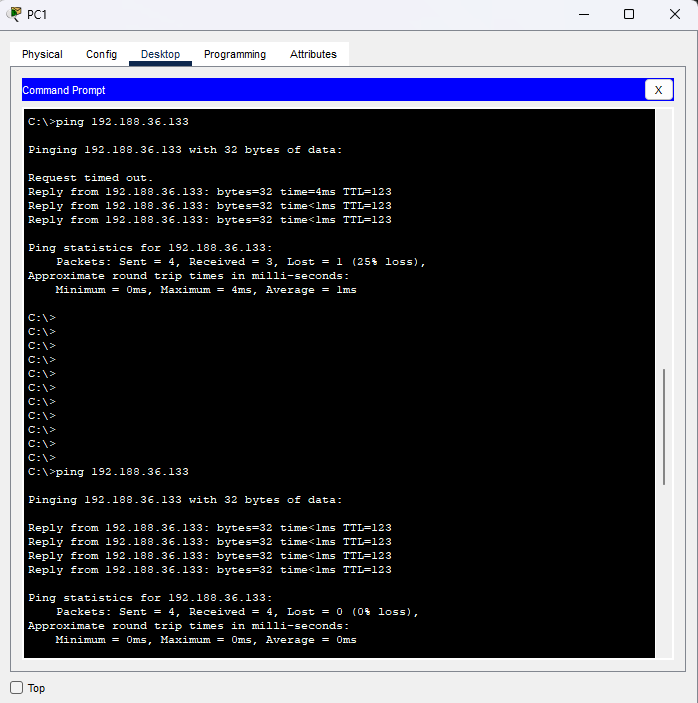

---

#### PRUEBA 3 — Acceso Total desde Administracion

| Campo | Detalle |
|---|---|
| **Descripcion** | PC0 (ADMIN) puede alcanzar todos los hosts de usuario |
| **Origen** | PC0 — VLAN 99 — IP: `192.188.36.194` |
| **Destinos** | PC1 (`192.188.36.3`), PC2 (`192.188.36.66`), PC3 (`192.188.36.133`), Laptop2 (`192.188.36.164`) |
| **Resultado** | **EXITOSO** — 100% de hosts alcanzables desde ADMIN |

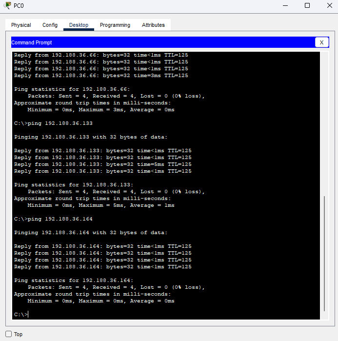

---

#### PRUEBA 4 — Bloqueos de Seguridad ACL

| # | Origen | Destino | Resultado Esperado | Resultado |
|---|---|---|---|---|
| 4a | PC2 Verde IZQ (`192.188.36.66`) | PC1 Naranja IZQ (`192.188.36.3`) | DENEGADO | `Destination host unreachable` |
| 4b | PC2 Verde IZQ (`192.188.36.66`) | PC3 Naranja DER (`192.188.36.133`) | DENEGADO | `Destination host unreachable` |
| 4c | PC1 Naranja IZQ (`192.188.36.3`) | PC2 Verde IZQ (`192.188.36.66`) | DENEGADO | `Destination host unreachable` |
| 4d | PC1 Naranja IZQ (`192.188.36.3`) | Laptop2 Verde DER (`192.188.36.164`) | DENEGADO | `Destination host unreachable` |
| 4e | PC1 Naranja IZQ (`192.188.36.3`) | PC0 ADMIN (`192.188.36.194`) | DENEGADO | `Destination host unreachable` |
| 4f | PC2 Verde IZQ (`192.188.36.66`) | PC0 ADMIN (`192.188.36.194`) | DENEGADO | `Destination host unreachable` |

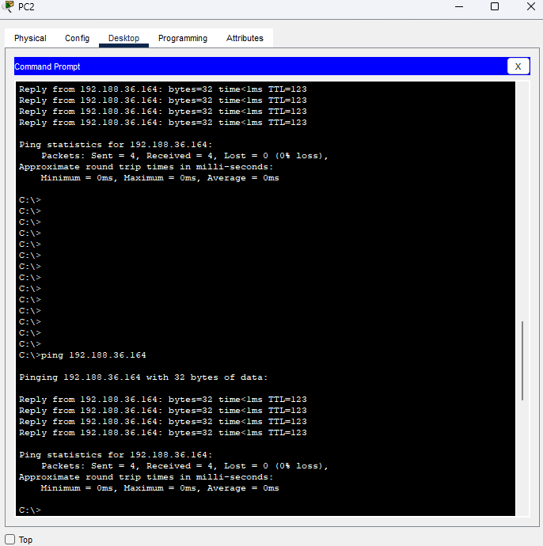

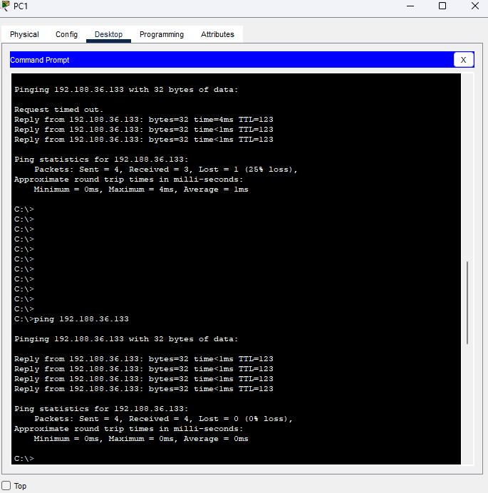

---

## 11. Tolerancia a Fallos

### 11.1 EtherChannel LACP — Edificio Izquierdo

**Escenario:** Se apaga (`shutdown`) la interfaz fisica `Fa0/1` del MSW_CORE_IZQ que forma parte de Port-Channel 1, mientras se mantiene un ping continuo activo.

**Comportamiento esperado:** El protocolo LACP detecta la falla del enlace y redistribuye automaticamente todo el trafico a traves de `Fa0/2`, que permanece activa dentro del mismo Port-Channel. El ping continuo **no debe interrumpirse**.

```cisco
! Procedimiento de prueba de fallo LACP:

! 1. Iniciar ping continuo desde PC1 hacia PC3 (desde el host)

! 2. En MSW_CORE_IZQ, simular falla del enlace:
interface FastEthernet0/1
 shutdown

! 3. Verificar el estado del bundle:
show etherchannel summary
! Resultado esperado:
!   Fa0/1 aparece como 'D' (Down)
!   Fa0/2 continua como 'P' (bundled en el port-channel)
!   Po1 sigue en estado 'U' (In use, funcionando)

! 4. Restaurar el enlace:
interface FastEthernet0/1
 no shutdown
```

**Resultado Obtenido:** El trafico continuo sin perdida de paquetes. El failover fue transparente al protocolo ICMP.


### 11.2 EtherChannel PAgP — Edificio Derecho

**Escenario:** Se apaga (`shutdown`) la interfaz `Fa0/4` del MSW_DIST_DER, miembro del Port-Channel 20 hacia SW3_ACCESO_DER.

```cisco
! Procedimiento de prueba de fallo PAgP:

! 1. Iniciar trafico continuo desde host en VLAN 40 hacia host en VLAN 20

! 2. Simular falla en MSW_DIST_DER:
interface FastEthernet0/4
 shutdown

! 3. Verificar redireccion:
show etherchannel summary
! Fa0/4 aparece como 'D', Fa0/3 mantiene el bundle activo en Po20

! 4. Restaurar:
interface FastEthernet0/4
 no shutdown
```

**Resultado Obtenido:** El trafico fue redirigido automaticamente. El Port-Channel 20 mantuvo conectividad con un solo enlace activo.


### 11.3 Redundancia OSPF en la Red MAN

La topologia en **anillo** de la MAN provee redundancia de caminos a nivel de capa 3. Si un enlace fisico entre dos switches de la MAN falla, OSPF recalcula automaticamente la mejor ruta alternativa usando el algoritmo SPF.

**Ejemplo de reconvergencia:** Si cae el enlace MSW_MAN_TOP <-> MSW_MAN_LEFT:

```
  Ruta primaria:  CORE_IZQ -> MAN_LEFT -> MAN_TOP -> DHCP1
                                                 (2 saltos en la MAN)

  Ruta alternativa (post-fallo):
                  CORE_IZQ -> MAN_LEFT -> MAN_ADMIN -> MAN_RIGHT -> MAN_TOP -> DHCP1
                                                          (4 saltos, otro lado del anillo)
```

OSPF detecta la caida del enlace, redistribuye los LSAs y recalcula el SPF en milisegundos, garantizando la continuidad del servicio.

---

## 12. Glosario Tecnico

| Termino | Definicion |
|---|---|
| **ACL** | Access Control List. Lista de reglas secuenciales que el router evalua para permitir o denegar trafico IP. |
| **Area 0** | Area Backbone de OSPF. Todas las demas areas OSPF deben conectarse a ella. |
| **DHCP Relay** | Funcion que reenvía solicitudes DHCP broadcast como unicast hacia un servidor DHCP remoto. |
| **EtherChannel** | Tecnologia de agregacion de enlaces que combina multiples interfaces fisicas en un unico enlace logico. |
| **FLSM** | Fixed Length Subnet Masking. Todas las subredes tienen la misma mascara. Usado en enlaces P2P con /30. |
| **LACP** | Link Aggregation Control Protocol. Estandar IEEE 802.3ad para negociacion dinamica de EtherChannel. |
| **LSA** | Link-State Advertisement. Paquetes que los routers OSPF intercambian para construir la topologia. |
| **MAN** | Metropolitan Area Network. Red de area metropolitana que interconecta multiples edificios. |
| **OSPF** | Open Shortest Path First. Protocolo de enrutamiento dinamico de estado de enlace, estandar abierto. |
| **PAgP** | Port Aggregation Protocol. Protocolo propietario de Cisco para negociacion de EtherChannel. |
| **SPF** | Shortest Path First. Algoritmo de Dijkstra usado por OSPF para calcular la mejor ruta. |
| **SVI** | Switched Virtual Interface. Interfaz logica de capa 3 asociada a una VLAN en un switch multicapa. |
| **VLSM** | Variable Length Subnet Masking. Permite usar diferentes mascaras para optimizar el uso de IPs. |
| **VTP** | VLAN Trunking Protocol. Protocolo de Cisco para distribuir automaticamente la base de datos de VLANs. |
| **Wildcard** | Mascara inversa usada en OSPF y ACLs. `0` = bit debe coincidir, `1` = bit es irrelevante. |
| **`no switchport`** | Convierte una interfaz de switch de modo L2 a modo L3, permitiendo asignarle una IP directamente. |
| **`established`** | Keyword ACL que coincide con paquetes TCP que tienen el bit ACK activo (sesion ya iniciada). |
| **`ip helper-address`** | Habilita el DHCP Relay en una interfaz L3, convirtiendo broadcasts DHCP en unicasts dirigidos. |
| **`channel-group mode active`** | Configura LACP en modo activo: envia PDUs de negociacion proactivamente. |
| **`channel-group mode desirable`** | Configura PAgP en modo activo/deseable: solicita la formacion del bundle. |
| **`channel-group mode auto`** | Configura PAgP en modo pasivo: solo responde a solicitudes, no las inicia. |

---

## Estructura del Repositorio

```
REDES2_1S2026_202201336/
├── README.md                        <- Este manual tecnico
├── Proyecto1_202201336.pkt          <- Archivo de simulacion Cisco Packet Tracer
├── [RC2]Proyecto 1.pdf              <- Enunciado oficial del proyecto
└── imagenes/                        <- Capturas de pantalla de la simulacion
    ├── image.png
    ├── image-1.png
    ├── image-2.png
    ├── image-3.png
    ├── image-4.png
    ├── image-5.png
    ├── image-6.png
    ├── image-7.png
    ├── image-8.png
    ├── image-9.png
    ├── image-10.png
    ├── image-11.png
    ├── image-12.png
    └── image-13.png
```

---

<div align="center">

**Universidad de San Carlos de Guatemala**  
**Facultad de Ingenieria — Escuela de Ciencias y Sistemas**  
**Curso: Redes de Computadoras 2**  
**Proyecto 1: Chapin Red — Primer Semestre 2026**

*Estuardo Josue Vaquiax Reyes — Carne 202201336*

</div>